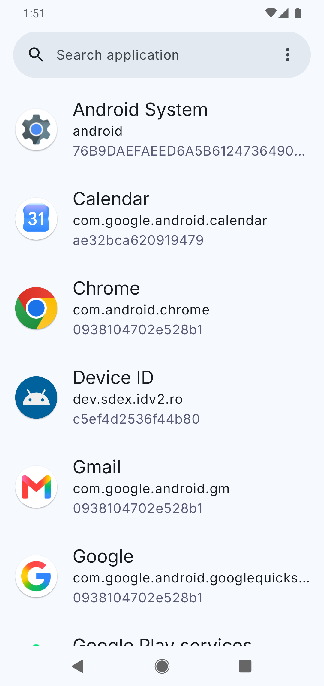
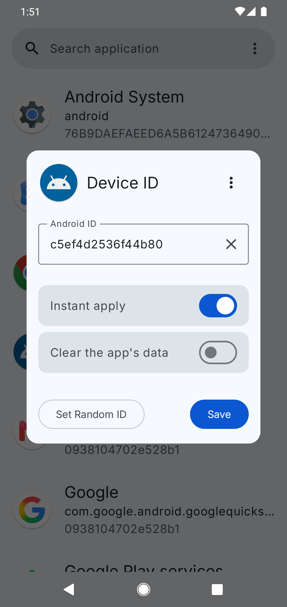
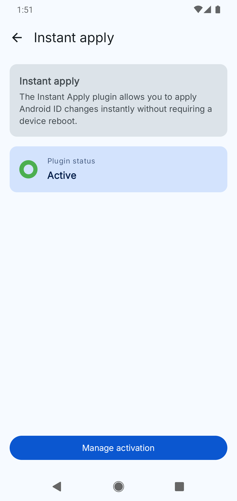

# Device ID Changer for Android [ROOT]

Change the Android ID of any app on a rooted device. Free, Android 8 to 16.

Device ID Changer lists your apps with their Android IDs and lets you set a new one, generate a
random one, back it up, and restore it. Since Android 8, each app gets its own ID, so you can change
the ID one app sees without touching the others.

|  |  |  |
|---|---|---|

## Download

- **[Latest APK from GitHub Releases](https://github.com/sdex/AndroidIDeditorV2/releases/latest)**:
  download the `.apk` and install it. To update, install the new APK over the old one; your backups
  and activation are kept.
- **Obtainium**: add `https://github.com/sdex/AndroidIDeditorV2` to get updates automatically, or
  [add it from your phone](https://apps.obtainium.imranr.dev/redirect?r=obtainium://add/https://github.com/sdex/AndroidIDeditorV2).

Release APKs are signed with this certificate (SHA-256):

```
41:BB:00:33:B0:3D:CC:3D:38:2B:AC:03:FC:CD:31:6B:F0:B6:46:B8:8A:BD:E2:83:24:0B:FD:2F:CA:C4:88:38
```

## Features

- List apps with their Android ID
- Search the app list
- Change the ID of any app, or generate a random one
- Validate every ID before writing it, to avoid corrupting the system file
- Copy, back up, and restore IDs
- Export the app list with IDs to a CSV file
- Multi-user support
- Instant Apply (paid add-on): the new ID takes effect without a reboot

## Instant Apply

A new ID normally needs a reboot. With Instant Apply it works as soon as you save it: only the app
you changed is stopped, so it picks up the new ID while the rest of the phone keeps running. It's a
one-time payment with no subscription. A license covers one device, and you can move it to a new
phone.

**[Get Instant Apply →](https://sdex.dev/id/)**

## Requirements

- Root, for example Magisk. The app doesn't work without it.
- Android 8 to 16 (Instant Apply: Android 10 to 16).

## How to use

1. Open the app and grant superuser access.
2. Pick an app from the list.
3. Enter a new ID or tap **Set Random ID**. An ID is 16 characters: digits and letters A to F, upper
   or lower case.
4. Tap **Save**.
5. Reboot for the new ID to take effect, or skip the reboot with Instant Apply.

## Frequently asked questions

**Why is an app missing from the list?** \
Android creates an ID for an app only when that app reads it for the first time. Open the app once,
then come back to Device ID Changer. Apps that never read the ID never appear.

**Why does an app still see its old ID?** \
Some apps keep their own copy of the ID, so their data has to be cleared too. With Instant Apply,
turn on **Clear the app's data** before you tap **Save**: Device ID Changer applies the new ID first,
then clears that app's data. Only the Android ID changes: apps that use other
[device fingerprinting](https://github.com/fingerprintjs/fingerprintjs-android) signals can still
recognize the device.

**How do I restore an app's original ID?** \
Restore it from a backup, or uninstall that app, reboot, and install it again: Android derives the
ID from the app's signature, so you get the original ID back.

Instant Apply, licenses, moving to a new phone, and troubleshooting are covered in the
[full FAQ](https://sdex.dev/id/faq.html).

## Privacy

- No ads, analytics, or tracking libraries.
- Instant Apply sends the license server only what it needs to tie the license to one device: the
  license key, a device key the app creates, a device hash, and the device model.
- The app never sends logs on its own; you choose when to send them.

Details: [Privacy Policy](https://sdex.dev/id/privacy.html)

## Terms

The app is provided as is, free, and without any guarantees or support. \
It edits system files with root, so you use it at your own risk: always make backups.

Instant Apply is sold under the [Terms of Service](https://sdex.dev/id/terms.html): buying or
activating a license means agreeing to them.
