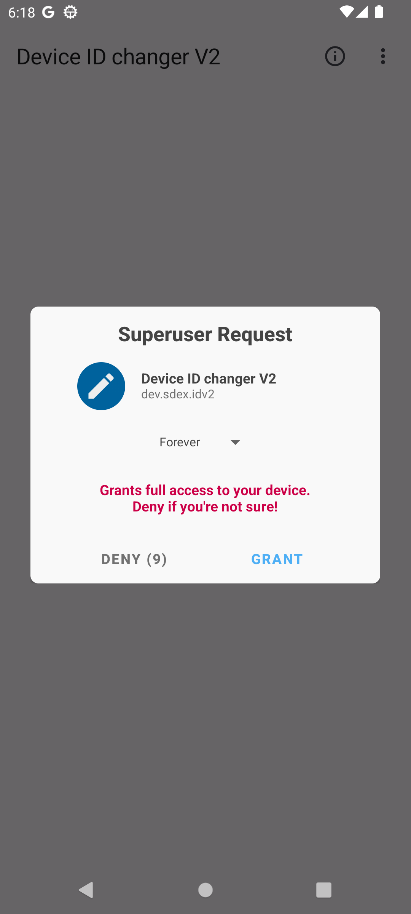
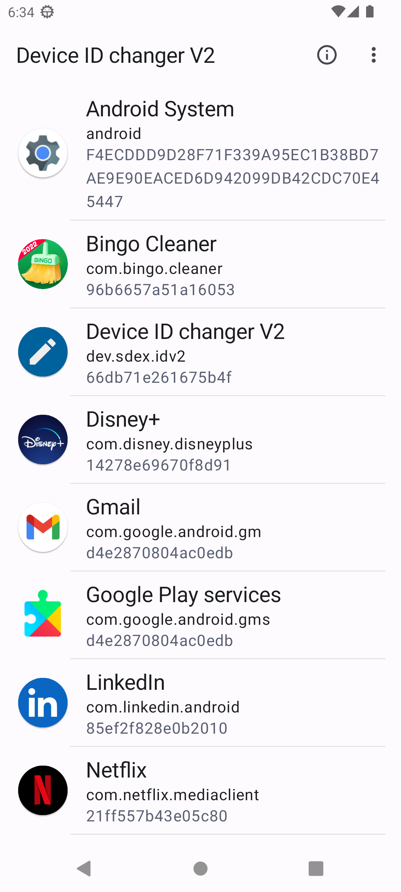
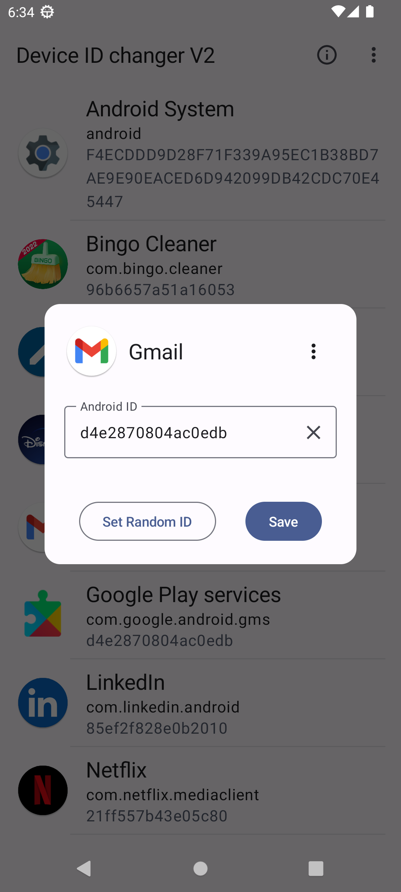

# Device ID Changer for Android [ROOT]

**Change the Android ID of any app on a rooted device. Free, Android 8 to 16.**

Device ID Changer lists every app with its Android ID and lets you set a new one, generate a random
one, back it up and restore it. Since Android 8.0 each app gets its own ID, so you can change the ID
one app sees without touching the others.

|  |  |  |
|---|---|---|

## Download

- **[Latest APK from GitHub Releases](https://github.com/sdex/AndroidIDeditorV2/releases/latest)**:
  download the `.apk` and install it. Install new versions over the old one; your backups and
  activation stay.
- **[Obtainium](https://obtainium.imranr.dev/)**: add `https://github.com/sdex/AndroidIDeditorV2`
  (or tap on [this link](https://apps.obtainium.imranr.dev/redirect?r=obtainium://add/https://github.com/sdex/AndroidIDeditorV2) on your phone) to get updates automatically.

Release APKs are signed with this certificate (SHA-256), which you can check with
[AppVerifier](https://github.com/soupslurpr/AppVerifier) or `apksigner verify --print-certs`:

```
41:BB:00:33:B0:3D:CC:3D:38:2B:AC:03:FC:CD:31:6B:F0:B6:46:B8:8A:BD:E2:83:24:0B:FD:2F:CA:C4:88:38
```

## Features

- List all apps with their Android ID
- Change the ID of any app, or generate a random one
- Validate every ID before writing it, to avoid corrupting the system file
- Copy, back up, and restore IDs
- Export the app list with IDs to a CSV file
- Multi-user support
- Search the app list
- **Instant Apply** (paid add-on): the new ID takes effect immediately, without a reboot

## Change the ID without a reboot: Instant Apply

A new ID normally takes effect only after a reboot. **Instant Apply**
applies it the moment you save it. Only the app you changed is stopped, so it picks up the new ID; the rest of the phone
keeps running.

- Android 10 to 16, rooted
- Android 13 and newer: setup first tries to work without an Xposed framework; where the device
  doesn't allow it, it asks you to install LSPosed or [Vector](https://github.com/JingMatrix/Vector)
- Lifetime license, one-time payment: one device, movable to a new phone

**[Get Instant Apply →](https://sdex.dev/id/)**

## Requirements

- **Root.** The app needs a root solution that grants `su` to apps, such as Magisk.
  It doesn't work without root.
- Android 8 to 16 (Instant Apply: Android 10 to 16).

## How to use

1. Install Device ID Changer and open it.
2. Grant superuser access.
3. Pick an app from the list.
4. Enter a new ID or tap **Set Random ID**. An ID is 16 characters: digits and letters A to F, in
   any case.
5. Tap **Save**.
6. Reboot to apply the change, or let Instant Apply apply it right away.

## Frequently asked questions

**Why is an app missing from the list?** \
Android creates an ID for an app only when that app reads it for the first time. Open the app once,
then come back to Device ID Changer. Apps that never read the ID never appear.

**The app still sees its old ID.** \
Some apps save the ID in their own storage; use the option to clear the app's data after applying a
new ID. Device ID Changer changes the Android ID only: apps that use other
[device fingerprinting](https://github.com/fingerprintjs/fingerprintjs-android) signals can still
recognize the device.

**How do I restore an app's original ID?** \
Restore it from a backup, or uninstall the app, reboot, and install it again: Android derives the ID
from the app's signature, so you get the original ID back.

**More questions** about Instant Apply, licenses, moving to a new phone and troubleshooting:
**[full FAQ](https://sdex.dev/id/faq.html)**.

## Privacy

- No ads, analytics, or tracking libraries. The IDs you set are never sent.
- Instant Apply sends only what it needs to tie the license to one device: the license key, a device
  key the app creates, a device hash, and the device model.
- Logs are sent only when you send them yourself with **Contact us**.

Details: [Privacy Policy](https://sdex.dev/id/privacy.html)

## Report an issue

In the app, tap ⋮ → **Contact us**, describe the problem, and send the email to support@sdex.dev.
The app attaches its logs, the list of installed apps with their IDs and some device information
that help find the cause. Without the app at hand, email support@sdex.dev.

## Terms

The app edits system files with root, so you use it at your own risk: always make backups. Using it
means agreeing to the [Terms of Service](https://sdex.dev/id/terms.html). Instant Apply purchases
come with a full refund within 14 days: see the [Refund Policy](https://sdex.dev/id/refund.html).
