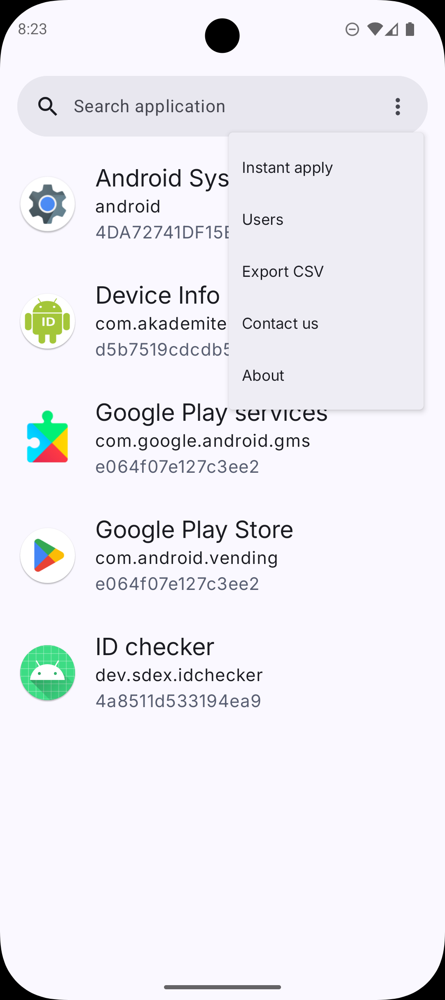
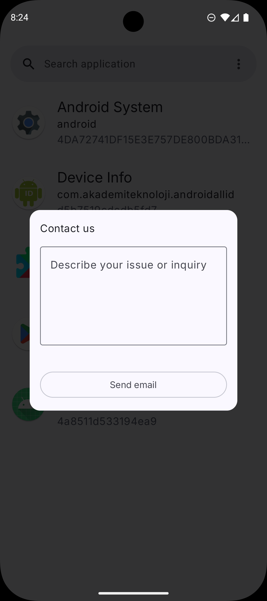

### The app requires root permission; it won't work without it.

AndroidIDeditor does not automatically collect and send any information. \
The only way to report the issue is to send the app's logs from the app: 
1. Click on the three dots icon at the top right corner and then select "Contact us". 
2. Write a message describing the issue. 
3. Send the email with the attached file.

|  |  |
|---|---|

### Changing the Android ID is not always enough

The target app might use its own [device fingerprinting](https://github.com/fingerprintjs/fingerprintjs-android), but unfortunately, this is beyond the capabilities of "Device ID Changer". \
The "Device ID Changer" changes the Android ID.

### Why is an app missing from the list?

Android creates an ID for an app only when that app reads it for the first time, so the list shows only apps that have done so.
After a factory reset or on a new device, open the app once, then come back to Device ID Changer and it will appear in the list.
Some apps never read the ID, so they never appear.

### How do I restore the original ID? 

To restore the original ID for any application you should uninstall this application, reboot your device, and then reinstall it.
Android generates the ID based on the application signature, unless the signature changed (rare case) the ID will be restored. 
